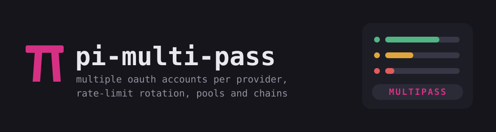

<p align="center">
  
</p>

<h1 align="center">pi-multi-pass · Pi + Oh My Pi (OMP)</h1>

<p align="center">
  <em>leeloo dallas. multi-pass.</em>
</p>

<p align="center">
  Multi-subscription extension for <a href="https://github.com/earendil-works/pi">Pi</a>
  and <a href="https://github.com/can1357/oh-my-pi">Oh My Pi (OMP)</a>.
  Use multiple OAuth accounts per provider with automatic rate-limit rotation and project-level affinity.
</p>

---

This fork adds OMP compatibility to [hjanuschka/pi-multi-pass](https://github.com/hjanuschka/pi-multi-pass)
while retaining the existing Pi integration. **OMP compatibility is tested with version 18.12.6.**

## Install with OMP

Use this fork's checkout to get the OMP adapter:

```bash
git clone https://github.com/geekz-reno/pi-multi-pass.git
cd pi-multi-pass
npm ci --omit=dev --ignore-scripts
omp install "$PWD"
```

If you already cloned the repository, run the last two commands from its root.
Start a new OMP session after installation. To try the extension for a single
session without installing it globally, run this from the repository root:

```bash
omp -e "$PWD/extensions/multi-sub.ts"
```

Inside OMP:

```text
/subs add       Add another provider account
/login          Authenticate the new account
/pool create    Group accounts for automatic rate-limit rotation
```

The `/subs`, `/pool`, and `/mp-preset` commands are available through the same
extension in Pi and OMP.

## Install with Pi

Install this fork with Pi's package manager:

```bash
pi install git:github.com/geekz-reno/pi-multi-pass
```

The original upstream Pi package is also available with `pi install npm:pi-multi-pass`.
Use this fork's checkout for the OMP changes described here.

## Pi and OMP configuration

| Setting | Pi | OMP |
|---|---|---|
| Global multi-pass config | `~/.pi/agent/multi-pass.json` | `~/.omp/agent/multi-pass.json` |
| Project multi-pass config | `.pi/multi-pass.json` | `.omp/multi-pass.json` |
| Credential storage | Pi's `auth.json` | OMP's native SQLite/broker store |
| Extra OAuth token keeper | Optional `/subs keeper` | OMP manages refresh ownership |

OMP profiles and host agent-directory overrides select the corresponding global
config directory. The detailed examples below use Pi paths; substitute the OMP
paths when using OMP. Existing Pi logins are not migrated automatically. Log in
through the host where you intend to use each account.

The OMP adapter uses the host's OAuth login callbacks, structured credentials,
and model catalog. Credentials remain in OMP's native store; multi-pass does not
create an OMP `auth.json` mirror. Concurrent refreshes use OMP's durable refresh
ownership instead of the separate Pi token keeper.

After a rate limit, multi-pass respects OMP's `willContinue` signal: it leaves
pending host retries alone and replays the captured prompt when the host has
stopped. `/subs statusbar` shows remaining quota in an OMP widget above the
editor, alongside widgets such as Headroom. OMP's custom footer API is a no-op;
Pi uses the custom footer instead.

## Validate OMP compatibility

With OMP installed and the runtime dependencies installed, run:

```bash
npm run test:omp
```

Run the focused feature and regression checks with Node.js 22.13+ and OMP:

```bash
npm run test:features
```

The joint smoke test loads this extension and the sibling `omp-headroom`
checkout in one isolated OMP session. Set `MULTIPASS_HEADROOM_CHECKOUT` to use
another Headroom checkout. It explicitly skips when that checkout is absent.
Provider and proxy calls are mocked; no paid requests or real logins run.

These integration checks use isolated configuration and dummy credentials,
disable outbound fetches, and cover provider registration, OAuth callback
wiring, durable refresh, project restrictions, failover, credential import,
and logout. Interactive OAuth login and paid model requests require your own
accounts and are not performed by the checks. Pi's existing integration tests
require a separate Pi installation.

## Features

- **Multiple subscriptions**: Add extra OAuth accounts for any provider
- **Rotation pools**: Group subscriptions and auto-rotate on rate limits
- **Smart pool strategies**: `round-robin`, `per-turn`, `quota-first`, `scheduled` (time windows), `custom` (JS script hook)
- **Fallback chains**: Define ordered cross-pool/model failover via `/pool chain`
- **Opt-in routing trace**: Record recent selection, skip, and failover decisions only when requested
- **Model presets**: Named routing shortcuts across providers (`/mp-preset coding-premium`)
- **Built-in limits checks**: Inspect subscription headroom across accounts with `/subs limits` (Anthropic, Codex, Google)
- **Experimental offline OAuth sharing**: Copy one selected account using QR frames or a single copy/paste export string (no network required)
- **Opt-in token keeper**: One OAuth refresh per machine instead of one per pi process, so parallel sessions cannot burn each other's rotating refresh tokens (`/subs keeper`)
- **Smarter retries**: Preserve failover progress across internal replay retries
- **Project affinity**: Restrict which subs/pools/chains are used per project
- **TUI management**: `/subs`, `/pool`, and `/mp-preset` commands -- no config files needed
- **Labels**: Tag subscriptions (e.g. "work", "personal")
- **Live model catalogs**: Subscription providers mirror the base provider's
  merged model catalog (static builtin + pi.dev remote overlay from
  `models-store.json`) on every model refresh, so newly catalogued models
  (e.g. `gpt-6-astra` for Codex) reach extra accounts without a
  pi-multi-pass release

### MiniMax model choices

`/subs model`, new pool-chain entries, and new preset entries list
`MiniMax-M3.1-Flash` first, then `MiniMax-M3`, and leave the older catalog text
models out. Nothing is unregistered: saved chains, presets, explicit switches
and the current selection keep the complete catalog, and anything you declare in
`models.json` or another extension re-registers is never hidden. A host catalog
without M3 or M3.1-Flash keeps every text model it has.

pi's native `/model` picker is untouched, so with `/subs intercept-model` off you
can still reach the older models there.

## Quick start

```
/subs add              Pick a provider, add a subscription
/login                 Authenticate the new subscription
/subs switch           Manually switch to another subscription/provider
/subs limits           Check built-in quota support (Anthropic + Codex + Google)
/subs doctor           Diagnose configuration, credentials, and model availability
/subs stats            Per-account requests and token totals for this session
/pool create           Group subs into a rotation pool (with strategy selection)
/pool chain create     Build an ordered fallback chain across pools
/pool trace start      Start recording routing decisions for this session
/pool preview          Preview account selection and failover without a request
/pool weights          Configure weighted request balancing for a pool
/mp-preset create         Create a named routing preset across providers
/mp-preset coding-premium Activate a preset by name
```

When one account hits a rate limit during an assistant turn, multi-pass automatically switches to the next eligible target and retries.

## Commands

### `/subs` -- Subscription management

```
/subs              Open menu
/subs add          Add a new subscription
/subs remove       Remove a subscription
/subs login        Login or re-authenticate a subscription
/subs logout       Logout from a subscription
/subs switch       Manually switch to a subscription/provider now
/subs list         List subscriptions with auth status; select one for quick actions
/subs status       Detailed status (token expiry, pool membership)
/subs doctor       Inspect raw configs, project restrictions, credentials and models
/subs stats        Current-session per-account request/input/output/total tokens
/subs limits       Check built-in quota/usage support (Anthropic + Codex + Google)
/subs statusbar    Toggle persistent quota display (OMP widget / Pi footer)
/subs share        Show offline QR frames or a full copyable export string (experimental)
/subs receive      Paste the full string or frame URIs into another pi
/subs keeper       Toggle the shared OAuth token keeper (off by default)
```

### `/subs keeper` -- shared OAuth token keeper (opt-in)

Anthropic and OpenAI rotate the refresh token on every refresh and reject the
previous one (`refresh_token_reused`, `invalid_grant`). A rotation that never
reaches `auth.json` therefore costs the login. With many pi processes sharing
one `auth.json`, pi's per-process refresh loses that race often enough to
matter: its refresh deadline (15s) or its credential lock (30s stale) can
expire after the provider has already rotated.

Enabled with `/subs keeper` (or `"tokenKeeper": true` in
`~/.pi/agent/multi-pass.json`), multi-pass takes over refreshes:

- renews tokens 15 minutes before expiry, ahead of pi's own 5-minute window
- holds the same `auth.json` lock pi uses, re-reads inside it, and skips the
  network when another process already stored a usable token
- writes the rotated credential in that same locked transaction, so a slow
  provider or a cancelled request cannot drop it
- covers built-in logins (`anthropic`, `openai-codex`, ...) as well as extra
  subscriptions

Off by default: it changes who refreshes your credentials, so enable it only
if you actually run several pi sessions at once.

### `/pool` -- Rotation pool and chain management

```
/pool              Open menu
/pool create       Create a pool (pick provider, select members)
/pool list         Show pools; select one for quick actions
/pool chain        Open chain manager
/pool toggle       Enable/disable a pool
/pool remove       Delete a pool (keeps subscriptions; prunes linked chain entries)
/pool status       Member health (logged in, rate limited, cooling down)
/pool trace        Manage the opt-in routing decision trace
/pool preview      Read-only routing preview using current eligibility and cached quota
/pool weights      Set positive per-account weights and enable weighted routing
/pool project      Project-level config (restrict subs, override pools/chains)
```

### `/pool trace` -- Opt-in routing decisions

Tracing is disabled by default and stores nothing until explicitly started. Entries
are kept only in memory for the current pi session, with the newest 100 retained.
Prompt contents are not recorded.

```
/pool trace start   Clear old entries and begin recording
/pool trace show    Inspect selections, skipped candidates, and failovers
/pool trace status  Show whether recording is active
/pool trace stop    Stop recording while retaining captured entries
/pool trace clear   Delete captured entries
```

### `/pool chain` -- Ordered fallback chain management

```
/pool chain             Open chain manager
/pool chain create      Create a chain
/pool chain list        Show all chains
/pool chain toggle      Enable/disable a chain
/pool chain remove      Delete a chain
/pool chain status      Inspect chain entries and validity
```

### `/mp-preset` -- Model presets (named routing)

```
/mp-preset                 Open menu
/mp-preset activate        Switch to a preset's best available entry
/mp-preset <name>          Activate a preset by name directly
/mp-preset create          Create a new preset
/mp-preset list            Show all presets
/mp-preset toggle          Enable/disable a preset
/mp-preset remove          Delete a preset
```

## Project-level configuration

Use `/pool project` to configure per-project subscription affinity. This creates `.pi/multi-pass.json` in your project directory.

When `allowedSubs` is set, multi-pass now treats it as an exact allow-list for this project: active routing, pool membership, and chain traversal are all constrained to those provider names.

### Use case: separate work and personal accounts

```
# Global: you have 3 Codex accounts
/subs add   -> openai-codex-2 (label: work)
/subs add   -> openai-codex-3 (label: personal)

# Corp project: restrict to team accounts only
cd ~/work/corp-project
/pool project -> restrict -> select openai-codex-2 only

# Side project: allow everything (no restriction)
cd ~/side-project
# No .pi/multi-pass.json needed -- uses all global subs
```

### What project config can do

| Feature | Description |
|---|---|
| **Restrict subs** | Only allow specific provider names in this project (for example `openai-codex-2` or `openai-codex`) |
| **Override pools** | Use different pools than global (or disable some) |
| **Override chains** | Use different fallback chains than global |
| **Clear** | Remove project config, fall back to global |
| **Info** | Show effective config (which pools/chains/subs are active) |

### Project config file

`.pi/multi-pass.json`:

```json
{
  "allowedSubs": ["openai-codex-2", "anthropic-2"],
  "pools": [
    {
      "name": "work-codex",
      "baseProvider": "openai-codex",
      "members": ["openai-codex-2"],
      "enabled": true
    }
  ],
  "chains": [
    {
      "name": "work-fallback",
      "enabled": true,
      "entries": [
        { "pool": "work-codex", "model": "gpt-5-mini", "enabled": true }
      ]
    }
  ]
}
```

- `allowedSubs`: whitelist of exact provider names. If set, only those exact providers are available in this project. Omit to allow all.
- `pools`: if set, replaces global pools for this project. Omit to inherit global pools.
- `chains`: if set, replaces global chains for this project. Omit to inherit global chains.

## How pools work

1. You're using `openai-codex` and hit a rate limit
2. Multi-pass detects the error, marks `openai-codex` as exhausted
3. Switches to `openai-codex-2` (same model ID, different account)
4. Retries your last prompt automatically
5. The account becomes eligible after its reported retry/reset time, or five minutes when the provider supplies no usable hint

Cooldowns use `Retry-After`, structured reset timestamps, and retry-duration
messages when available. A fresh quota snapshot with exhausted windows can extend
the delay until all known exhausted windows reset. `/pool preview` shows the
remaining cooldown; the original provider message is not stored in the trace.

### Pool selection strategy

Each pool has a `strategy` that controls account selection. The default switches only after a rate-limit error; `quota-first` also selects an account at session startup, and `per-turn` rotates before each new prompt:

| Strategy | Behavior |
|---|---|
| `round-robin` | Rotate sequentially through members on rate-limit failover (default) |
| `per-turn` | Rotate to the next usable member before each new prompt; keep tool calls and retries within that turn on the selected account, except rate-limit failover |
| `weighted` | Before each new prompt, prefer the usable account with the lowest finalized request count divided by its weight; preserve the account through continuations and retries |
| `quota-first` | Check quota at session startup, including the current account, and select the healthiest eligible member; check alternatives again on rate-limit failover |
| `scheduled` | Use per-member time windows and priority roles |
| `custom` | Delegate to a user-provided JS selector script |

Set the strategy during pool creation (`/pool create`) or change it later via `/pool list` -> select pool -> `strategy`.

Quota, schedule, and custom strategies fall back to round-robin when their specific data is unavailable.

#### `per-turn`

With accounts A and B in one enabled pool, each new prompt advances A → B → A, including repeated identical prompts. The selected model ID stays the same. Accounts without authentication, in a rate-limit cooldown, or missing that model are skipped. If no alternative can be selected, the current account stays active. Tool calls, host continuations, and automatic retries do not trigger another rotation; rate-limit errors still use the existing failover and retry flow. On OMP, queued follow-ups rotate when their next run starts; steering messages stay within the current turn. This alternates prompts, so it does not guarantee equal token usage.

Set `"strategy": "per-turn"` on the pool, or select `per-turn` in the pool strategy menu.

#### `weighted`

Run `/pool weights`, select a pool, and enter a positive weight for each account.
For weights 1 and 2, the second account receives about twice as many requests
over time. Missing weights default to 1. Authentication, cooldowns, project
restrictions and model availability still apply. Only rate limits can move a
running turn to another account.

```json
{
  "name": "codex-pool",
  "baseProvider": "openai-codex",
  "members": ["openai-codex", "openai-codex-2"],
  "enabled": true,
  "strategy": "weighted",
  "memberWeights": { "openai-codex": 1, "openai-codex-2": 2 }
}
```

`/subs stats` reports finalized assistant request counts and normalized token
usage for each account. Input totals include cache reads/writes. Counts reset
when a session starts, including resume; they are not billing or lifetime totals.
Weighted balancing uses request counts, so it does not promise equal token use.

`/pool preview` sends no prompt, performs no quota refresh, and does not execute
custom selector scripts or change routing state. It shows the next prompt's
account, rate-limit fallback order, and skipped accounts. Quota-first previews
use cached quota; custom strategy previews show their round-robin fallback.
`/subs doctor` checks raw configuration before normalization and reports
credential/selection problems without printing credentials or prompt contents.

#### `quota-first`

At session startup, `quota-first` checks every authenticated, eligible pool member that can serve the selected model, including the current account. If Codex A has 50% remaining and Codex B has 100% across the reported windows, it selects B before your first prompt. It keeps that account through subsequent prompts and checks alternatives again only on rate-limit failover.

Ranking uses the lowest remaining percentage across reported windows (for example, both 5h and 7d), rather than just the first displayed percentage. Equal scores keep the current account. Project restrictions and rate-limit cooldowns still apply, and the selected model ID stays the same. Quota lookups run once per session with a three-second deadline. Missing/failed quota data or no usable alternative leaves the current account unchanged; a late response cannot overwrite a user model/account change. OMP providers with several saved logins and no selected session account are excluded from this check.

For failover with 3 accounts, A at 80%, B at 20%, and C at 60%, it prefers A if A is an eligible alternative; the failed account is excluded.

Uses the same built-in quota checkers as `/subs limits`.

```json
{
  "name": "codex-pool",
  "baseProvider": "openai-codex",
  "members": ["openai-codex", "openai-codex-2", "openai-codex-3"],
  "enabled": true,
  "strategy": "quota-first"
}
```

#### `scheduled`

Assign each member a role and optional time windows:

- **preferred**: only used during its active windows. When multiple preferred members are active, the one whose window ends soonest goes first (burn that quota before the window closes).
- **default** (no role): always available, used after preferred members.
- **overflow**: last resort, used when preferred and default members are exhausted.

```json
{
  "name": "codex-pool",
  "baseProvider": "openai-codex",
  "members": ["openai-codex", "openai-codex-2", "openai-codex-3"],
  "enabled": true,
  "strategy": "scheduled",
  "memberSchedule": {
    "openai-codex": {
      "role": "preferred",
      "windows": [{ "hours": [9, 17], "days": ["mon", "tue", "wed", "thu", "fri"] }]
    },
    "openai-codex-2": {
      "role": "preferred",
      "windows": [{ "hours": [17, 9] }]
    },
    "openai-codex-3": {
      "role": "overflow"
    }
  }
}
```

Window format:
- `hours`: `[start, end)` in 24h local time. Wraps midnight when start > end (e.g. `[22, 6]` = 22:00-05:59).
- `days`: array of `"mon"`, `"tue"`, ..., `"sun"`. Omit for every day.
- `dateRange`: `{ "from": "2025-06-01", "to": "2025-06-30" }` for temporary windows.

During pool creation or via the `strategy` quick action, you can configure schedules interactively with human-friendly input like `9-17 mon-fri`.

#### `custom`

Point to a JS script that decides which member to try first. The script receives full context and returns the preferred provider name (or an ordered array).

```json
{
  "name": "codex-pool",
  "baseProvider": "openai-codex",
  "members": ["openai-codex", "openai-codex-2", "openai-codex-3"],
  "enabled": true,
  "strategy": "custom",
  "selectorScript": "selectors/my-codex-selector.js"
}
```

Script paths are resolved relative to `~/.pi/agent/`. Absolute paths and `~/` paths also work.

**Selector script interface:**

```js
// ~/.pi/agent/selectors/my-codex-selector.js
module.exports = async function select(ctx) {
  // ctx.members:         string[]  -- available (non-exhausted, authenticated) members
  // ctx.currentProvider: string    -- the provider that just hit a rate limit
  // ctx.modelId:         string    -- the model ID being used
  // ctx.pool:            object    -- { name, baseProvider, members }
  // ctx.timestamp:       number    -- current Unix timestamp (ms)
  // ctx.hour:            number    -- current hour (0-23, local time)
  // ctx.day:             string    -- current day of week ("mon".."sun")
  // ctx.prompt:          string?   -- last user prompt, if available
  //
  // Return: string (provider name), string[] (ordered preference), or undefined (fall back)

  // Example: prefer a specific account during business hours
  if (ctx.hour >= 9 && ctx.hour < 17) {
    return ctx.members.find(m => m === "openai-codex-2");
  }
  return ctx.members[0];
};
```

If the script throws, returns an invalid provider name, or the file is missing, the pool falls back to round-robin.

## How chains work

1. You define an ordered chain of pool/model entries (for example `primary -> backup -> solo`)
2. If the current pool has no eligible members, multi-pass continues forward in the chain
3. It skips disabled or invalid entries and reports why in warnings
4. During retry replays for the same prompt, it preserves cascade state and avoids re-trying already attempted providers
5. Session status shows the active chain start entry: `chain:<name> | starts <pool> -> <model>`

## Model presets

Presets are named routing shortcuts that map to an ordered list of provider+model entries across different providers. Think of them as intent-based routing: `coding-premium`, `coding-budget`, `fastest`, etc.

### Commands

```
/mp-preset              Open menu
/mp-preset activate     Switch to a preset's best available entry
/mp-preset <name>       Activate a preset by name directly
/mp-preset create       Create a new preset
/mp-preset list         Show all presets
/mp-preset toggle       Enable/disable a preset
/mp-preset remove       Delete a preset
```

### Example

```
/mp-preset create
  Name: coding-premium
  Entries:
    1. anthropic / claude-sonnet-4-20250514
    2. openai-codex / o3
    3. google-gemini-cli / gemini-2.5-pro

/mp-preset coding-premium
  -> Tries anthropic first. If not logged in, tries openai-codex. Then gemini.
```

### Config

Presets are stored in `~/.pi/agent/multi-pass.json`:

```json
{
  "presets": [
    {
      "name": "coding-premium",
      "enabled": true,
      "entries": [
        { "provider": "anthropic", "model": "claude-sonnet-4-20250514", "enabled": true },
        { "provider": "openai-codex", "model": "o3", "enabled": true },
        { "provider": "google-gemini-cli", "model": "gemini-2.5-pro", "enabled": true }
      ]
    },
    {
      "name": "coding-budget",
      "enabled": true,
      "entries": [
        { "provider": "openai-codex", "model": "gpt-4.1-mini", "enabled": true },
        { "provider": "google-gemini-cli", "model": "gemini-2.5-flash", "enabled": true }
      ]
    }
  ]
}
```

Presets work with pools: if an entry's provider belongs to a pool, rate-limit failover still rotates within that pool before trying the next preset entry.

## Supported providers

| Provider key | Service |
|---|---|
| `anthropic` | Claude Pro/Max |
| `openai-codex` | ChatGPT Plus/Pro (Codex) |
| `github-copilot` | GitHub Copilot |
| `google-gemini-cli` | Google Cloud Code Assist |
| `google-antigravity` | Antigravity |

## Built-in limits support

`/subs limits` uses a provider-specific checker registry.

Quota checks have a ten-second deadline and retain successful account results
when another account fails or times out. The quota widget can refresh again
after a stalled check; session-start selection keeps its shorter three-second
deadline.

Currently implemented:

- `anthropic`: fetches Claude subscription usage from `https://api.anthropic.com/api/oauth/usage`, then summarizes the 5-hour and 7-day windows plus any model-scoped weekly limits (for example Opus) for the base account and extra Anthropic subscriptions. Plan and email come from the OAuth profile endpoint.
- `openai-codex`: fetches ChatGPT/Codex usage from `https://chatgpt.com/backend-api/wham/usage` (or `CHATGPT_BASE_URL`), then summarizes each account's returned quota windows, including 5-hour, 7-day, and 30-day windows, for the base account and any configured extra Codex subscriptions.
- `google-gemini-cli`: refreshes the saved Google OAuth session when needed, then queries `https://cloudcode-pa.googleapis.com/v1internal:retrieveUserQuota` and summarizes the returned Gemini quota buckets by their bottleneck family (for example `Pro` or `Flash`).
- `google-antigravity`: refreshes the saved Antigravity OAuth session when needed, then queries `v1internal:fetchAvailableModels` on the Google Cloud Code Assist endpoints with Antigravity-style headers and summarizes the returned model-level bottleneck.

Google quota is not a single flat subscription bucket, so the details view shows one line per returned Gemini family or Antigravity model with its remaining headroom and reset time.

`/subs limits` is an on-demand snapshot. It helps you see which account looks healthiest right now. Automatic switching still happens when the active provider returns a rate-limit-style runtime error and that provider belongs to an enabled pool or chain.

For a persistent display, run `/subs statusbar`. It refreshes quota every five
minutes and remembers the toggle across sessions. In OMP, a rounded box above the
editor shows each supported account's remaining windows and reset times; `●`
marks the active account. Percentages turn yellow at 30% remaining and red at
15%; the box wraps to fit narrow terminals. Run the command again to hide it. In Pi, the same
toggle enables the custom footer with each account's lowest remaining percentage.
The OMP box also shows `pool: <name>` for the active provider's rotation pool,
or `pool: none` when it does not belong to an enabled pool for this project.
When Headroom is running, its box appears on the left and Multi Pass on the right
in a shared row. Narrow terminals stack the boxes instead. Disabling Multi Pass
restores Headroom's separate widget.
When OMP stores multiple native logins under one provider, the display follows
the credential selected for the current session rather than the first saved login.
Until OMP selects a login, the display says `waiting for OMP account selection`.
Account changes bypass the five-minute quota cache; the widget checks after turns,
model changes, and on its regular display tick. Responses for a previous login
are discarded.

When a pool uses the `quota-first` strategy, the same quota checkers are used automatically during failover to pick the healthiest member instead of just round-robin.

When a project defines `.pi/multi-pass.json` with `allowedSubs`, `/subs limits` only shows accounts allowed in that project.

Future providers can add another checker without changing the `/subs` command surface.

## Experimental: share an OAuth account

`/subs share` picks one authenticated OAuth account and renders it as one or more numbered QR frames. Scan every frame in any order with a compatible receiver; use `n`/`p` to advance/backtrack, `u` to reveal a frame URI, or `c` to open a **single copyable export string** in pi's editor for pi-to-pi transfer. On the other computer, run `/subs receive` and choose `Paste one full export string` (or paste QR frame URIs individually). Line breaks from terminal wrapping are accepted in the full string. No network, listener, relay, or source computer uptime is required after capture. The receiver imports under a new extra-subscription name, never overwrites an existing credential, and must restart pi to register the new provider. Omarchy on the *same* machine already reads pi's local auth and does not need this transfer.

**Security:** The frames contain the **entire OAuth access and refresh credential**. Base64 and compression are not encryption. Anyone who captures all frames can use the account; the frames do **not expire or self-destruct** when you close the display. Only share in a private setting with a device you trust. To invalidate leaked credentials, revoke them at the provider. Do not screenshot, log, or upload the QR URIs or full string. Copying to a system clipboard may sync the credential to other devices or retain it in clipboard history; clear it after import. See [offline QR protocol](docs/share-protocol.md) for the v2 frame and text formats.

**Provider caveat:** OAuth refresh credentials can be rotated or bound to one device/client. Copying a credential can break the source or receiver's next refresh; durability is **not yet validated provider by provider**. This is experimental, not a guarantee of two simultaneously working logins. If either device stops authenticating, log in again on that device. The command does not copy pools, chains, presets or project config. Mobile receivers still need to implement the offline QR decoder and provider-specific secure credential storage; no mobile receiver ships in this package yet.

## Environment variable (optional)

```bash
export MULTI_SUB="openai-codex:2,anthropic:1"
```

Env entries merge with saved config.

## Config files

| File | Scope | Contains |
|---|---|---|
| `~/.pi/agent/multi-pass.json` | Global | Subscriptions + pools + chains |
| `.pi/multi-pass.json` | Project | Pool/chain overrides + sub restrictions |

## License

MIT
